# NIFTY_IV_RESEARCH

**A research system for testing whether a trend-and-swing signal on the NIFTY index can be turned into option-selling strategies, using real minute-by-minute option prices.**

> **Status: research, not a trading system.** The prices are 1-minute OHLC candles, not bid/ask quotes. Margin comes from a scenario table, not live SPAN. Nothing here is validated trading evidence. The current version is `4.9.12-research` (see `src/nifty_iv/VERSION.txt` and `docs/CODEMAP_V4_9_11.md`), and 620 synthetic tests pass.

---

## Contents

1. [What the project does](#1-what-the-project-does)
2. [System overview](#2-system-overview)
3. [The signal: zones and swings](#3-the-signal-zones-and-swings)
4. [From signal to trade](#4-from-signal-to-trade)
5. [The zone pipeline, stage by stage](#5-the-zone-pipeline-stage-by-stage)
6. [Selection: how a strategy earns trust](#6-selection-how-a-strategy-earns-trust)
7. [Data periods and the holdout](#7-data-periods-and-the-holdout)
8. [Research findings so far](#8-research-findings-so-far)
9. [Running it](#9-running-it)
10. [Repository map](#10-repository-map)
11. [The dormant relative-IV calendar pipeline](#11-the-dormant-relative-iv-calendar-pipeline)
12. [Guarantees and limitations](#12-guarantees-and-limitations)

---

## 1. What the project does

The question being tested:

> *When the **INDEX v15** indicator (a TradingView Pine script) marks NIFTY as being in a **green** (bullish) or **red** (bearish) zone, and price confirms with a qualifying swing, does **selling an option in the direction of the zone** make money after realistic fills, margin limits and costs? And does it do so **consistently, year after year**?*

The aim is a portfolio of two strategies, one green and one red, sharing one **₹25 lakh** account. Each strategy is sized by margin, not by a fixed lot count. The gates a strategy must pass are set in advance:

| Gate (current) | Value |
|---|---|
| Average return per strategy | > 13 % p.a. on capital |
| Every full year | ≥ 10 % p.a. |
| Worst single trade (drawdown at the worst bar-close mark) | ≤ 3 % of capital |
| Fill rate (entries actually filled) | ≥ 75 % |
| Year stability band | every full year > 0, worst year ≥ 0.70 × mean year |

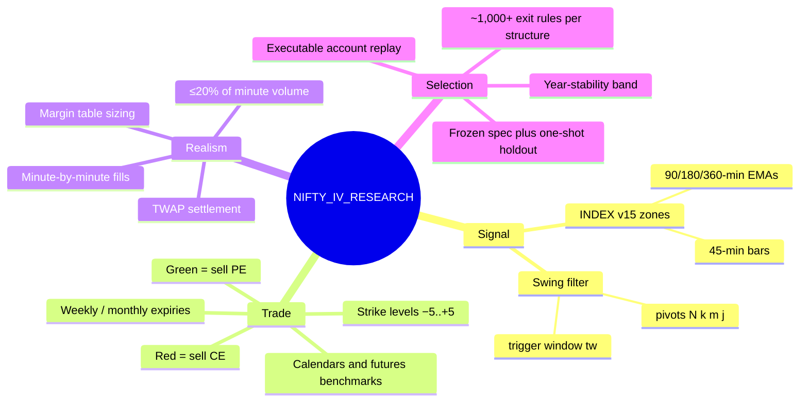

---

## 2. System overview

The database is the only external input, and the code only ever **reads** it. Each stage writes its own local SQLite or NPZ artefact, and every stage after the spot extract checks the hashes of the stage before it.

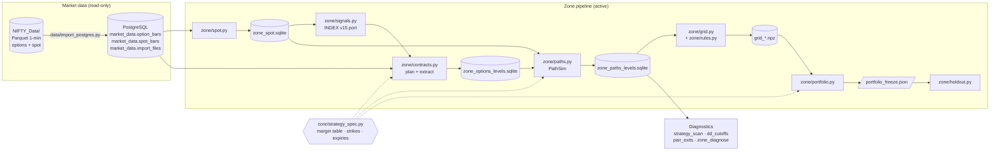

The indicator itself is in `pine/INDEX_v15_zone_swing.pine`. `zone/signals.py` is a bar-for-bar Python port of it.

---

## 3. The signal: zones and swings

### 3.1 Bars and EMAs

Minute spot data is grouped into **45-minute bars aligned to the 09:15 open**, the same way TradingView builds them (bars close at 10:00 … 15:15, followed by a short 15:15–15:30 bar). Higher-timeframe bars of 90, 180 and 360 minutes are built the same way. A higher-timeframe value reaches a 45-minute bar only **after its own bar has closed**, the equivalent of Pine's `lookahead_off`.

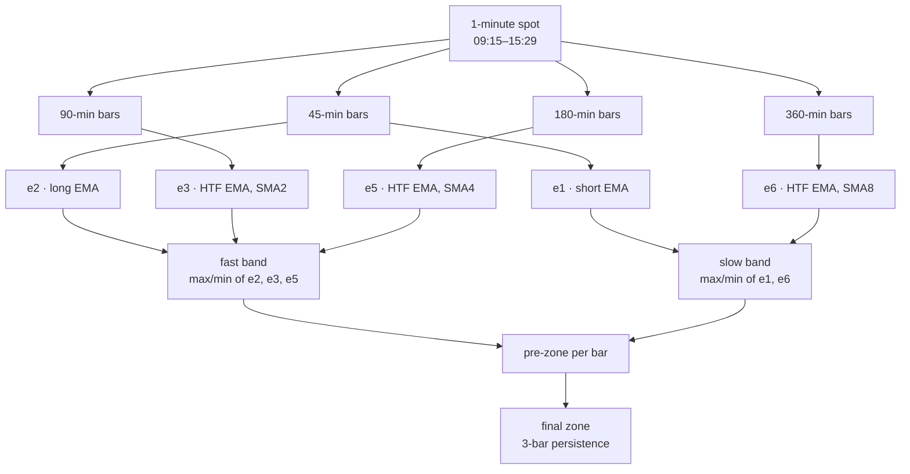

### 3.2 Zone state machine

Each bar's close is compared with both bands:

- **Above everything:** pre-zone `G`.
- **Below everything:** pre-zone `R`.
- **Between the bands, or inside one:** the previous pre-zone carries over.

The **final** zone changes only after **three consecutive bars** agree.

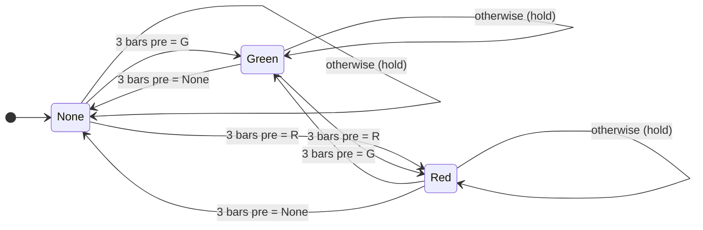

### 3.3 Swing filter and entry

A zone alone is not an entry. The bull side needs a **rising valley** and the bear side a **falling peak**:

```
 Bull side (green zone): a qualifying higher low

  price
    │            ▲ bounce ≥ k·ATR
    │   ╲      ╱ ╲           ╱──── close > pivot level ──► ENTRY
    │    ╲    ╱   ╲   ╱╲    ╱       (between tw and tw+16 bars
    │     ╲  ╱     ╲ ╱  ╲  ╱         after confirmation, zone = G)
    │      ╲╱       ╳    ╲╱ ◄── new pivot low, ≥ j·ATR above the last
    │   last pivot  │     │
    │      low      │◄─N─►│ confirmed N bars after its centre
    │      ◄──── gap ≥ m bars ────►
    └──────────────────────────────────────────────► 45-min bars
```

| Parameter | Meaning | Grid values |
|---|---|---|
| `N` | pivot half-width in bars (also the confirmation delay) | 3, 5 |
| `k` | minimum bounce between pivots, × ATR(14) | 0.25 … 1.5 (6 values) |
| `m` | minimum bars between successive pivots | 8, 12, 16, 20 |
| `j` | minimum rise of the new low over the last, × ATR | 0.25 … 1.5 (6 values) |
| `tw` | bars to wait after confirmation before the trigger can fire | 2 … 6 |

That gives **2 × 6 × 4 × 6 × 5 = 1,440 swing configurations**, plus **5 `zone_only_tw2..6` controls** (enter `tw` bars after a zone flip, with no swing filter). The total is **1,445 signal configurations**. A configuration's name encodes its values, for example `N5_k0.25_m12_j1.0_tw5`.

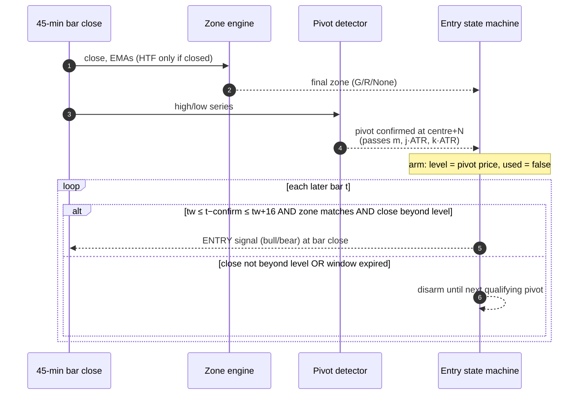

Every decision is made **at bar close**. Nothing that prints later can gate or price an entry.

---

## 4. From signal to trade

### 4.1 Direction, strike and expiry (`core/strategy_spec.py`)

| Zone | Side | Sells | Strike |
|---|---|---|---|
| Green | bull | **Put** (PE) | ATM − level × step |
| Red | bear | **Call** (CE) | ATM + level × step |

The **level** runs from −5 to +5. A positive level is **OTM**, a negative level is **ITM**, and 0 is ATM. The **step** depends on the index level at the signal: 50 below 5,000, 100 below 12,000, and 200 above that.

```
 Red zone (sell CE), index 24,130 → ATM 24,200, step 200

   ITM ◄──────────────────── ATM ────────────────────► OTM
   −5    −4    −3    −2    −1     0    +1    +2    +3    +4    +5
 23,200 23,400 23,600 23,800 24,000 24,200 24,400 24,600 24,800 25,000 25,200
```

**Structures** simulated for every signal:

| Structure | What it holds |
|---|---|
| `naked` | short in the nearest listed expiry with ≥ `min_short_days` (the control) |
| `naked_m1` | short in the current month's monthly expiry, only if ≥ 21 days remain |
| `naked_m2` | short in next month's monthly expiry |
| `calendar` | short near expiry + long far expiry; the short rolls at 15:15 on its expiry, the long when ≤ 30 days are left |
| `futures_zone` | futures benchmark held until the zone changes (spot proxy, 1 pt slippage) |
| `futures_expiry` | futures benchmark held to expiry |

### 4.2 Sizing by margin

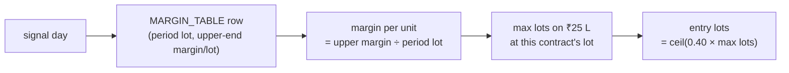

Margin is charged **per unit**, so a contract trading with a different lot size during a transition window is charged in proportion to its own lot. The table covers 2004 to 2026 and is meant to be extended as new data arrives.

### 4.3 Life of one simulated position (`zone/paths.py`, `PathSim`)

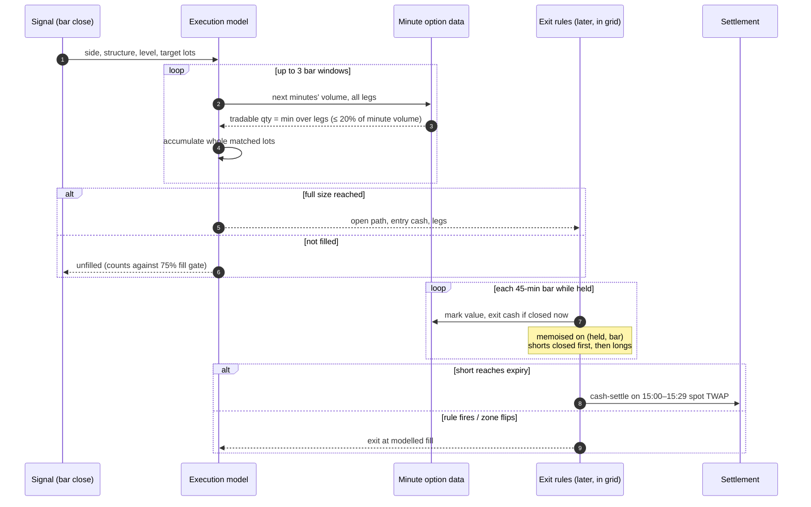

A path is simulated **once per (signal bar × side × structure × level)** and shared by every configuration that fires on that bar. That reuse is what makes it feasible to evaluate hundreds of millions of rule combinations.

---

## 5. The zone pipeline, stage by stage

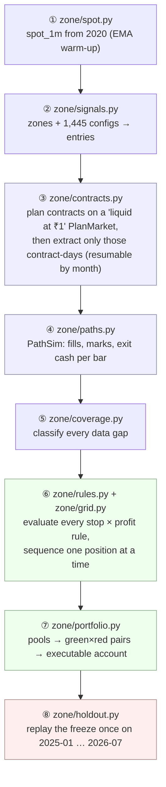

### Exit rule families (`zone/rules.py`)

Each structure has about **1,000–1,250 stop rules** and **34–50 profit rules**:

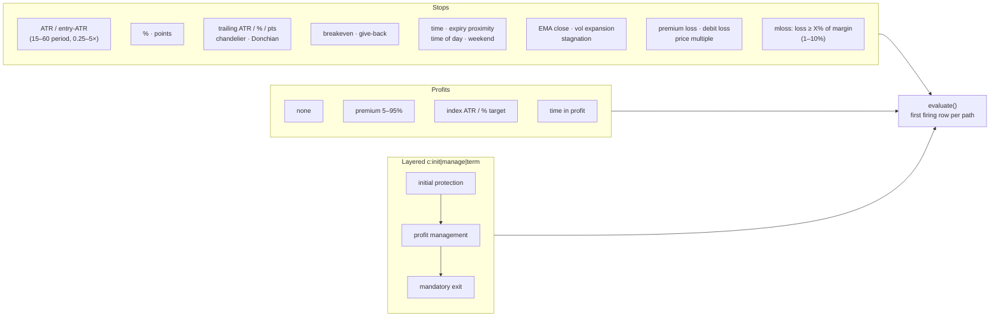

The grid stores `n, total, wins, sumsq` for every **configuration × window × profit × stop** in `grid_<side>_<struct>_<lvl>__<stopfamily>.npz`. Positions are **sequenced one at a time** per (configuration, rule). If a data gap occurs while a position is held, the slot stays busy until the zone flips (gap policy `busy`).

---

## 6. Selection: how a strategy earns trust

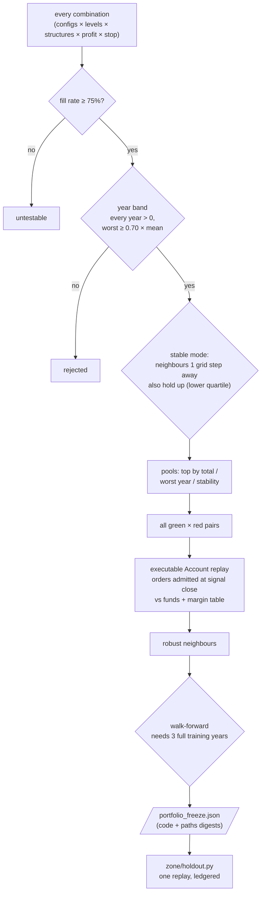

Supporting checks:

- **Lineage.** `algorithm_digest` hashes the rules file, kernels, layout, holidays, gap policy and `strategy_spec`, and every grid file has its own SHA. `--report-only` refuses to run against mismatched inputs.
- **Leave-one-year-out (LOYO)** and **fill bias** (ATM filled vs unfilled entries) are reported alongside every result.
- **Allocation.** Each leg is judged against **5/12** of the account target, floor and drawdown limit (a pair against 10/12). This is a nominal share, to be tuned later to actual margin use.

---

## 7. Data periods and the holdout

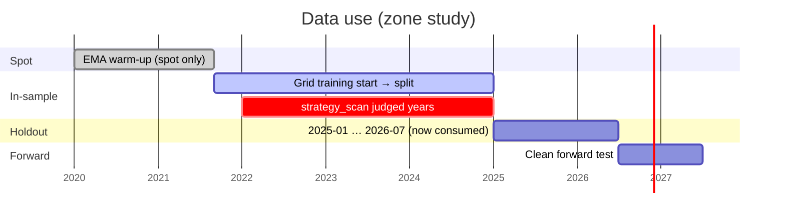

- The split is hard-capped at **2025-01-01**. Nothing after it is read during selection.
- A walk-forward year needs three full training years before it, so with this data **no in-sample walk-forward year exists**. The holdout is the only forward test.
- The 2025–26 holdout has now been looked at by the diagnostics (`dd_cutoffs`, `pair_exits` and others). The **only clean test left is data after June 2026.**

---

## 8. Research findings so far

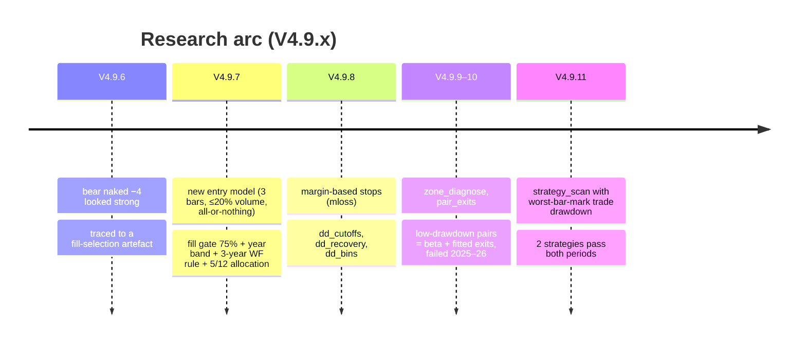

| Finding | Detail |
|---|---|
| Monthlies and calendars | Cannot be tested in-sample: far expiries are listed regularly only from 2024 |
| Portfolio pairs | No green × red pair passes the drawdown gate |
| `strategy_scan` | 19,808 combinations pass 13 / 10 / 3 on 2022–24. The long side fails 2026 H1 almost entirely |
| **Survivors** | 6 combinations pass both periods, which amounts to **2 strategies**: **bear naked level −2**, `N5_k0.25_m12_j{1.0,1.25}_tw5`, stop `eatr{30,45,60}×0.25`, profit `none` / `ptime5` |
| Next step | Write the frozen spec and forward-test it on data after June 2026 |

---

## 9. Running it

### Install and verify

```bash
python -m pip install -e ".[fast,test]"     # package + console scripts; numba (fast) optional
python -m pytest                             # 620 synthetic tests (ZONE_NO_NUMBA=1 for the numpy path)

export PGHOST=localhost PGPORT=5432 PGDATABASE=nifty_data PGUSER=postgres
read -rs -p 'PostgreSQL password: ' PGPASSWORD; echo; export PGPASSWORD
```

Every tool is a console script (`nifty-zone-*`, `nifty-diag-*`, `nifty-data-*`, `nifty-iv-*`) and also runs as `python -m nifty_iv.<subpackage>.<module>`. Run from `runs/` (ignored by git) so outputs stay out of the source tree. The Parquet importer reads `data/NIFTY_Data/` unless `NIFTY_DATA_ROOT` is set.

### Zone pipeline (V4.9.7+ levels study)

```bash
set -o pipefail; cd runs
nifty-zone-spot      --from-date 2020-01-01 --to-date 2026-07-01 --out zone_spot.sqlite
nifty-zone-signals   --spot zone_spot.sqlite --split 2025-01-01 --out zone_signals.json
nifty-zone-contracts --spot zone_spot.sqlite --offset-mode levels \
    --structures naked,naked_m1,naked_m2,calendar --out zone_options_levels.sqlite
nifty-zone-paths     --options zone_options_levels.sqlite --spot zone_spot.sqlite --offset-mode levels \
    --structures naked,naked_m1,naked_m2,calendar,futures_zone,futures_expiry \
    --target-margin 2500000 --out zone_paths_levels.sqlite
nifty-zone-coverage  --options zone_options_levels.sqlite --paths zone_paths_levels.sqlite --out coverage_paths
nifty-zone-grid      --paths zone_paths_levels.sqlite --holidays ../config/nse_holidays.txt --workers 4 --out zone_grid_levels
nifty-zone-portfolio --grid zone_grid_levels --paths zone_paths_levels.sqlite \
    --holidays ../config/nse_holidays.txt --workers 4 --out portfolio_levels
```

### Diagnostics on the paths file

```bash
nifty-diag-strategy-scan --paths zone_paths_levels.sqlite --holidays ../config/nse_holidays.txt \
    --min-mean 0.13 --min-year 0.10 --max-trade-dd 0.03 --judge-years 2022,2023,2024 --out strategy_scan.csv
nifty-diag-dd-cutoffs    --paths zone_paths_levels.sqlite        # touches the 2025–26 period
nifty-diag-equity-dd-scan --paths zone_paths_levels.sqlite --holidays ../config/nse_holidays.txt \
    --caps 0.15,0.175,0.20 --min-year 0.07 --out equity_dd_scan.csv   # best single green / red per drawdown cap
nifty-diag-trade-ledger --paths zone_paths_levels.sqlite --options zone_options_levels.sqlite --spot zone_spot.sqlite \
    --holidays ../config/nse_holidays.txt --strategy bear,naked,-2,N5_k0.25_m12_j0.25_tw5,ptime7,eatr30x1.5   # every trade's fills, costs, margin, interest
```

### Holdout (once, when selection is final)

```bash
nifty-zone-holdout --freeze portfolio_levels/portfolio_freeze.json --paths zone_paths_levels.sqlite
```

**Resources.** The grid takes hours and tens of GB, and each worker needs 1–3 GB of RAM (use `--workers 2` on a 16 GB machine). `--resume` re-hashes finished files and continues from where it stopped. Setting `ZONE_NO_NUMBA=1` disables numba, with identical results.

The version-by-version option reference is `docs/guides/README_V4.md` plus `docs/notes/`. Those files use the old flat script names; `docs/MODULE_MAP.md` translates them.

---

## 10. Repository map

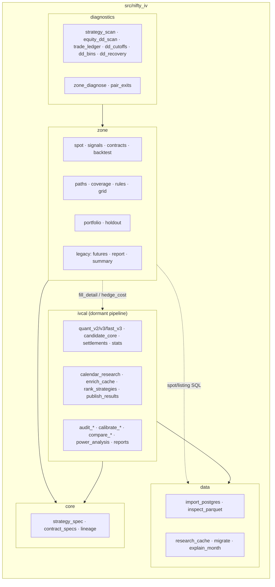

| Path | Contents |
|---|---|
| `src/nifty_iv/` | the package (layout above); `VERSION.txt` is the release string written into run metadata |
| `src/nifty_iv/data/migrations/` | PostgreSQL schema migrations (`research_v3`) |
| `tests/` | `test_zone.py`, `test_paths.py`, `test_v3.py`, `test_v4.py` (synthetic only) |
| `config/` | inputs: `nse_holidays.txt` |
| `pine/` | `INDEX_v15_zone_swing.pine` (TradingView source of the signal) |
| `scripts/` | `smoke_v3.py` (synthetic IV-pipeline run), `check_import_psql.sh`, `cleanup_outputs.sh` |
| `docs/` | `guides/` (install, import, V2/V4 guides) · `notes/` (V4.x release notes) · `validation/` · `research/` (reviews, pilot results) · `CHANGES_V4.md` · `CODEMAP_V4_9_11.md` · `MODULE_MAP.md` |
| `data/` | not tracked: Parquet tree (`data/NIFTY_Data`) |
| `runs/` | not tracked: every run output |
| `archive/` | superseded code (`legacy_v1/`, `v2_tools/`, `scripts/`) |

Release zips are no longer committed. Every earlier snapshot remains in git history (commits before the reorganisation).

---

## 11. The dormant relative-IV calendar pipeline

The project began as a study of **NIFTY put calendars timed by relative implied volatility** (front IV vs back IV, forward IV, IV vs realised vol). That pipeline is still in the repo but is not being run.

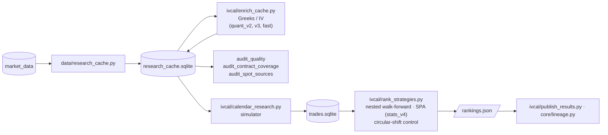

Its fill and hedge-cost functions (`fill_detail`, `hedge_cost`) are reused by `zone/paths.py`.

---

## 12. Guarantees and limitations

**Guarantees**
- Market data is read-only. No program alters `market_data.*`.
- No lookahead. Higher-timeframe values arrive only after their bar closes, entries are decided at the 45-minute bar close, and fills use volume printed after the decision.
- Reproducible. Grid, freeze and holdout are bound by code and data digests, and a mismatch is refused, not silently re-run.
- Uncertainty is explicit. A data gap is never treated as a fill (`not_extracted`, `no_short_expiry`, `listing`), and the gap policy is recorded.

**Limitations**
- Prices are OHLC minute candles, not quotes. The participation cap and next-minute fills are proxies.
- Margin is an upper-end scenario table, not broker SPAN.
- Futures are a spot proxy (no basis, no volume). Carry is assumed at 5.5 %.
- Monthly and far-expiry structures have thin in-sample coverage before 2024.
- The 2025–26 holdout is spent. Forward data is the only clean evidence.
- **Licensing:** confirm vendor licences before any commercial use. The 1-minute options dataset is stated as CC BY-NC 4.0.
